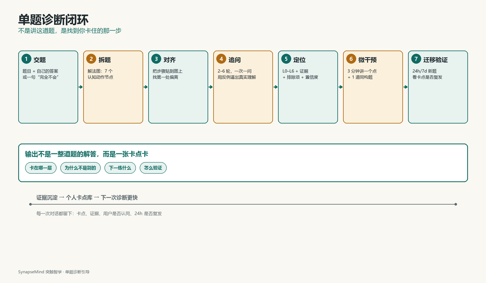

# SynapseMind 突触智学

> **不是讲这道题，是找到你卡住的那一步。**

一个“单题诊断引导”产品：学生发来一道**不会/做错的题**，加上**自己的答案或过程**（也可以只说“完全不会”），系统用 2–6 轮追问，找到他**最早断掉的认知动作**，给一张带证据的卡点卡、3 分钟微干预和一道迁移题。

**状态**：产品设计方案 v0.2、技术选型 v0.3 已完成；**M1 walking skeleton 已可本地运行**：单题交题 → 解法图对齐 → 2 轮探针 → L2 卡点卡；M2 的 LLM 生成、RAG、迁移验证、数据库与鉴权尚未接入。不是已上线产品。

## 现在能跑什么

| 能力 | 状态 | 位置 |
|---|---|---|
| 交题 + 过程 | ✅ 文本、预填示例题 | `apps/web` |
| 状态机（显式转移表） | ✅ 10 个状态、事件驱动 | `apps/api/src/synapse/domain/dialogue/` |
| 步骤对齐 + 首个断点 | ✅ 规则版（M2 换 LLM 策略） | `domain/problem/alignment.py` |
| 假设后验 + 探针选择 | ✅ 3 个假设、2–6 轮、0.80/0.25 阈值 | `domain/diagnosis/` + `application/planner.py` |
| 答案泄漏防护 | ✅ 禁用词 + 5-gram 出口装饰器 | `domain/guard/` + `application/composer.py` |
| 卡点卡 + 独立卡页 | ✅ L2 示例、证据/排除/置信度/下一练 | `application/card_builder.py` + `/card/[sessionId]` |
| 持久化 | ⏳ 内存仓储（重启即丢） | `infrastructure/in_memory.py` |
| 拍照、LLM、RAG、24h 验证 | ⏳ M2/M3 | 设计见 `docs/design/` |

## 本地启动

需要 Python 3.12+、Node.js 22+。一条命令启动 API + Web（首次会建 venv、装依赖）：

```powershell
python scripts/dev.py
# Windows 也可以：.\scripts\dev.ps1
```

打开 `http://localhost:3000`；API 文档在 `http://localhost:8000/docs`。`Ctrl+C` 会同时停掉两个进程。

只检查环境、不启动：

```powershell
python scripts/dev.py --check
```

手动分开启动（调试用）：

```powershell
# 终端 1：API
cd apps/api
python -m venv .venv
.\.venv\Scripts\Activate.ps1
pip install -e ".[dev]"
uvicorn --app-dir src synapse.api.main:app --reload --port 8000

# 终端 2：Web
cd apps/web
npm install
npm run dev
```

### 契约生成

接口 DTO 是源，Web 的 TS 类型是生成物：

```powershell
python scripts/contracts.py
```

它先导出 OpenAPI 到本地忽略目录，再用 `openapi-typescript` 生成 `apps/web/src/lib/api/generated.ts`；该文件已入库，fresh clone 不跑 Python 也能 typecheck/build。

### 检查命令

```powershell
# 后端
cd apps/api
pytest
ruff check src tests
mypy src
.\.venv\Scripts\lint-imports.exe

# 前端
cd apps/web
npm run typecheck
npm run lint
npm run build
```

当前只支持一道种子题（函数与导数、参数分类）。换题会返回 422，这是 M1 的显式边界，不是静默降级。

## 它怎么工作

| 步骤 | 系统做什么 | 用户看到 |
|---|---|---|
| 1. 交题 | 文本/拍照；分离题目与答案 | “先确认题目识别对不对” |
| 2. 拆题 | 生成解法图：读题、概念、条件、策略、执行、校验 | “这题分几步”（不展开答案） |
| 3. 对齐 | 把用户步骤贴到图上，找第一处偏离 | “你写到第 2 步时用了一个前提” |
| 4. 追问 | 2–6 轮，一次一问，用反例/二选一逼出真实理解 | 一个具体问题 + 选项/输入框 |
| 5. 定位 | L0–L6 卡点 + 证据 + 排除项 + 置信度 | “你卡在 L2，不是不会求导” |
| 6. 微干预 | 3 分钟讲一个点 + 1 道同构题 | 一张概念卡 + 一道小题 |
| 7. 验证 | 24h/7d 新题复测 | “明天用新题验证，不用同一道” |

## 一个片段：答案对，过程漏了条件

题目：`f(x)=ln x - a x`，`a∈R`，若 `f(x)≤0` 对任意 `x>0` 恒成立，求 `a` 的取值范围。

学生答案：`f'(x)=1/x-a`，令 `f'(x)=0` 得 `x=1/a`，最大值 `ln(1/a)-1≤0`，所以 `a≥1/e`。**答案对，但漏了 `a≤0`。**

系统没有说“你漏了 a≤0”，而是问：

> “当 `a=0` 时，`f'(x)` 是什么？在 `x>0` 上有零点吗？”

学生：“`1/x`，没有零点。”

> “那 `a=0` 时，`f(x)=ln x` 会不会超过 0？”

学生：“会，`x>1` 就大于 0。”

> “再看 `a=-1`：`f'(x)=1/x+1` 有零点吗？`f(x)` 单调怎样？”

学生：“没有零点，一直增；x 很大时 `ln x + x` 也很大，肯定超过 0。”

> “所以‘令 `f'(x)=0` 得 `x=1/a`’要求 `a` 满足什么？”

学生：“`a>0`。a<0 时 1/a 是负的，不在定义域；a=0 也不行。”

**卡点卡**：L2 条件转译 / 参数分类；证据是“在 a=0、a=-1 时仍沿用 x=1/a”；排除“求导、解不等式”；置信度 0.86；下一练是“存在性三步检查”。

## 五个可演示亮点

1. **单题入口**：不是先做 12 分钟测评，而是从用户当下卡住的那道题开始。
2. **第一处偏离**：不是看最后错在哪，而是找最早让解题链断掉的认知动作。
3. **一次一问**：每轮只问一个可回答的问题，用具体反例/二选一，不用“懂了吗”。
4. **诊断卡 + 我不同意**：卡点、证据、排除项、置信度、下一练；用户能否决。
5. **答案单向阀**：检索、Prompt/schema、出口、回归四道闸；学习模式拿不到最终答案。



## 不是什么

| 不是 | 为什么 |
|---|---|
| 题库/搜题 | 搜题给答案，我们给“你卡在哪” |
| AI 家教 | 家教讲整题，我们只追问一个点，讲 3 分钟就停 |
| 智商测试 | 不输出 IQ、百分位、等级；七维只在后台做“探针镜头” |
| 完整课程 | MVP 只做高中数学“函数与导数” |
| 提分承诺 | 只承诺更准确地找到下一个该练的点 |

## MVP 边界

| 项 | 决策 |
|---|---|
| 学科 | 高中数学“函数与导数” |
| 题量 | 100 道种子题，30 道深标 |
| 输入 | 文本 + 拍照；答案可文本/手写 |
| 输出 | 卡点卡 + 3 分钟微干预 + 1 道迁移题 |
| 团队/周期 | 3 人 / 8 周 |
| 架构 | 3 个容器（web/api/worker）；PostgreSQL + pgvector；Redis；无 K8s/Spring Cloud/MySQL |
| 技术栈 | Next.js + TypeScript；Python 3.12 + FastAPI + Pydantic v2；Arq worker |
| 评测 | 与双教师卡点一致率 ≥75%；“说中了” ≥70%；答案泄漏 0 |
| 生死线 | 50 次诊断一致率 <60%，停止扩张 |

## 仓库结构

```text
.
├─ apps/                    # 运行单元（M1：web + api 可运行；worker 仍设计）
│  ├─ web/                  # Next.js + TS：交题/追问/卡点卡/SEO
│  ├─ api/                  # Python + FastAPI：状态机/诊断/AI/SSE
│  └─ worker/               # Python + Arq：OCR 后处理/ETL/评测（与 api 同镜像）
├─ specs/                   # 状态机 + JSON Schema（先于代码）
├─ docs/
│  ├─ adr/                  # 架构决策记录；0001 是技术选型准绳
│  ├─ design/
│  │  ├─ chapters/          # 第 0–12 章，手写源
│  │  └─ assets/            # 3 张设计图
│  └─ reference/skill.txt   # 能力清单原文
├─ eval/
│  ├─ golden/               # 100 条双教师标注
│  └─ redteam/              # 50 条诱导/边界
├─ infra/                   # docker / nginx / observability 计划
├─ tools/                   # 文档生成、TOC、PDF
├─ scripts/                 # 仓库检查、一键启动、契约生成
└─ .github/workflows/ci.yml # repo / API / Web 三组检查
```

`docs/design/release/` 是本地生成目录（DOCX/PDF/合并稿），已加入 `.gitignore`，不上传；发布时作为 GitHub Release 附件。

每个目录“放什么、不放什么、什么时候才建”，见 [STRUCTURE.md](STRUCTURE.md)。

### 四条目录约定

1. **按可部署单元与领域分，不按语言/文件类型分**：`apps/` 放能独立构建/部署的单元，不建 `frontend/`、`backend/`、`java/`、`python/` 这类名字。
2. **文档源与产物分开**：改 `docs/design/chapters/`；`release/` 是本地产物，不进 Git。
3. **spec 先于代码**：改接口/状态机，先改 `specs/`，再改 `apps/`；生成的 TS 类型在 M1 放到 `apps/web/src/lib/api/`，不预建空 `packages/`。
4. **先单体后拆分**：代码先落在 `apps/api/src/synapse/` 的包边界；拆分触发条件写在 ADR 与 `apps/api/README.md`，`services/` 目录等真正要拆时再建。

## 从哪里读

| 文档 | 内容 |
|---|---|
| [语言与代码架构 ADR](docs/adr/0001-language-and-code-architecture.md) | **先看这篇**：5 个独立评审、评分、最终选型、迁移与改选条件 |
| 本地 Word/PDF | **不入库**；运行下方“构建设计文档”生成，发布时作为 GitHub Release 附件 |
| [一页纸](docs/design/chapters/00-一页纸.md) | 定位、示例、指标 |
| [核心体验](docs/design/chapters/02-核心体验.md) | 完整对话、四个分支、诊断卡 |
| [诊断引擎](docs/design/chapters/04-诊断引擎.md) | 解法图、L0–L6、假设与探针 |
| [Prompt 与 Agent](docs/design/chapters/05-Prompt与Agent.md) | 状态机、系统提示、JSON Schema、答案四道闸 |
| [RAG 与内容](docs/design/chapters/06-RAG与内容.md) | 五类知识卡、混合检索、引用 |
| [技术架构](docs/design/chapters/07-技术架构.md) | v0.3：2 种语言、3 个容器、14 张表、调用链、缓存与泄漏防线 |
| [skill.txt 映射](docs/design/chapters/08-skill映射.md) | 11 项落点与验收；Java/Spring/MySQL 项已标注 Phase 2 |
| [可行性与 MVP](docs/design/chapters/09-可行性与MVP.md) | 8 周计划、评测、成本、风险 |
| [状态机 spec](specs/dialogue-state.md) | 运行前先看这个 |
| [诊断卡 schema](specs/diagnosis.schema.json) | 输出契约 |

## skill.txt 的 11 项能力落在哪

> 选型原则：产品最优优先，不为“技能清单”硬加语言。Java/Spring/MySQL/Caffeine 在 MVP 主链路不再使用；如果目标是 Java 岗作品集，见 ADR §4 方案 C 与 §10 改选条件，而不是把主产品做成三语言。

| 能力 | 本项目落点 |
|---|---|
| Java/Python/Go + Hutool/Lombok + 规范 | **Python 主栈**（FastAPI/Pydantic）；Java/Go 不进 MVP；Hutool/Lombok 不适用；`ruff` + `mypy` + `import-linter` 守规范 |
| Spring Cloud + MyBatis + 单体拆微服务 | MVP **不引** Spring Cloud/MyBatis；Python 模块化单体 → 按触发条件再拆；拆分决策写 ADR |
| MySQL + 分表 + 索引 + Druid | MVP 用 **PostgreSQL 16 + pgvector**；保留联合/覆盖索引、慢查询、月分区；MySQL/Druid 作为 Phase 2 企业适配器备选，不冒充已实现 |
| Redis/Caffeine/锁/三防 | Redis 7：会话/幂等/限流/SSE 重放；本地缓存用 `cachetools`（Caffeine 等价物）；锁用 Redis 原子命令，布隆/空值缓存防穿透 |
| Docker/Nginx/Serverless | 3 容器 Compose；Nginx 关 SSE 缓冲；OCR/PDF 导出可选 FC |
| Prometheus/Grafana/ARMS/JVM | OpenTelemetry + Prometheus/Grafana；**不做 JVM 大盘**；做 Python/Node runtime 与对话全链路 trace |
| SEO/GEO | Next.js ISR + JSON-LD + `llms.txt`；公开“题目卡点库”100 页；TDK 与 AI 引用监测 |
| Spring AI/LangChain4j/RAG/MCP/多 Agent | MVP 不用 Spring AI/LangChain4j；Python 轻量 LLM gateway + RAG；MCP Server/多 Agent 作为 Phase 2/实验，控制流仍在状态机 |
| Prompt/PGvector/ETL/查询增强 | Pydantic/JSON Schema 受控输出；pgvector HNSW + pg_trgm + RRF；文档 ETL；查询改写 |
| Cursor/Claude Code/Copilot/MCP/Skills | 自建 MCP Server；`diagnostic-review`、`hint-policy` 两个 Skill |
| Vibe Coding/SDD/Harness/Spec-Kit | spec 先行；ADR；golden 回放；canary；回滚演练 |

完整映射见 [第 8 章](docs/design/chapters/08-skill映射.md)。

## 开发入口

M1 已落地一条可运行的最小闭环；下一步按这个顺序：

1. 读 [`specs/dialogue-state.md`](specs/dialogue-state.md)、三个 JSON Schema 与 [ADR-0001](docs/adr/0001-language-and-code-architecture.md)；
2. 在 `apps/api` 用现有 `StepAligner`/`ProbePlanner` 端口替换规则版，接 LLM 与 3 道题；
3. 在 `apps/web` 补 `/practice/[taskId]`、`/verify/[sessionId]`；
4. 把 10 条 golden 写进 `eval/golden/`，再谈 100 条；
5. 最后接 PostgreSQL/Redis，保持状态机与路由不变。

### 本地命令

```powershell
# API
cd apps/api
python -m venv .venv
.\.venv\Scripts\Activate.ps1
pip install -e ".[dev]"
uvicorn --app-dir src synapse.api.main:app --reload --port 8000

# Web
cd apps/web
npm install
npm run dev

# Worker（M2）
# uv run --project apps/api arq synapse.workers.settings.WorkerSettings
```

### 构建设计文档

```bash
python -m pip install -r tools/requirements.txt
python tools/diagrams.py
python tools/merge_markdown.py
python tools/generate_docx.py
pwsh tools/update_toc_and_export.ps1   # Windows + Word
python scripts/check_repo.py
```

产物写到 `docs/design/release/`，该目录已忽略、不上传；发布时把 PDF 作为 GitHub Release 附件。

CI 跑三组：`check_repo.py`（链接/契约）、API（ruff/mypy/import-linter/pytest）、Web（typecheck/lint/build）；不依赖 Word/网络。

## 诚实说明

- 这是**项目设计方案**，不是已上线产品；文中的完成率、成本、一致率均为目标或估算。
- **v0.3 已按 ADR-0001 统一第 7/8 章**；第 11 章保留旧 Java 设计过程，仅作为“无共享记忆子 Agent + 冲突裁决”的方法记录，不是当前架构。
- **DOCX/PDF 是本地生成物，不入库**；仓库只保留 Markdown 源，发布时把 PDF 放到 GitHub Release。
- 选 Python/TS 的代价是 skill.txt 的 Java/Spring/MySQL/Caffeine 四项在 MVP 主链路没有落点；这是有意的产品取舍，不是遗漏。
- MVP 只覆盖高中数学“函数与导数”的五类题型；任意题/全学科是 Phase 2。
- 当前没有真实用户数据、没有 100 条标注、没有疗效证据；第 9.8 节列了缺口。
- 旧版“12 分钟测评 + 学习 OS + 增长”方案已移到本地 `_local/archive/v0-broad-os/`，不上传；Git 历史里仍可追溯，但不占用仓库首页。
- License 尚未确定；公开前由维护者选择并添加 `LICENSE`。

**这个项目最难的不是模型，是 30 道题 × 每道 7–10 个节点的双人标注，以及让一个学生在第 3 轮还愿意回答。**

---

*文档版本 v0.3 · 2026-10-28 · 技术选型见 [ADR-0001](docs/adr/0001-language-and-code-architecture.md) · 贡献前请读 [CONTRIBUTING.md](CONTRIBUTING.md)*