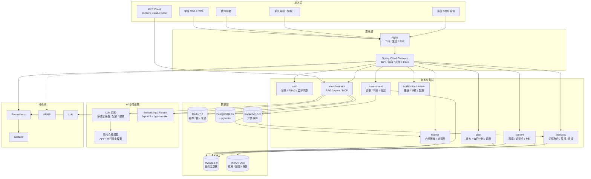
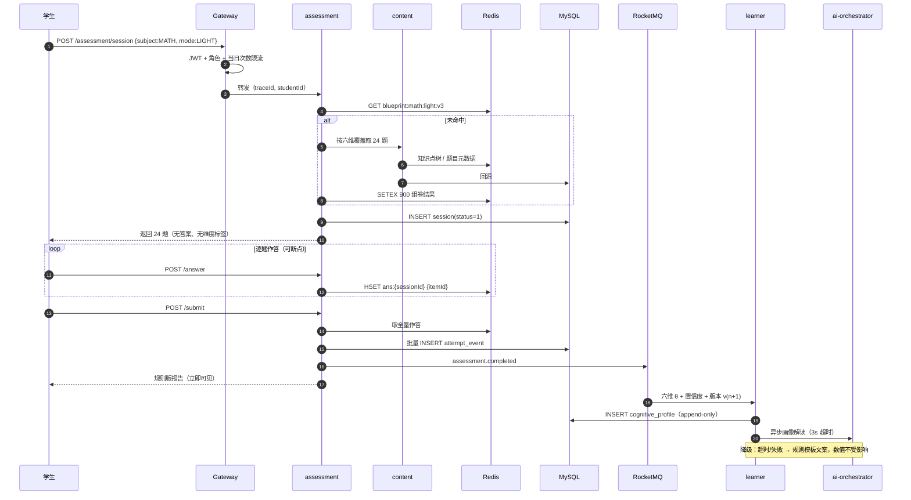
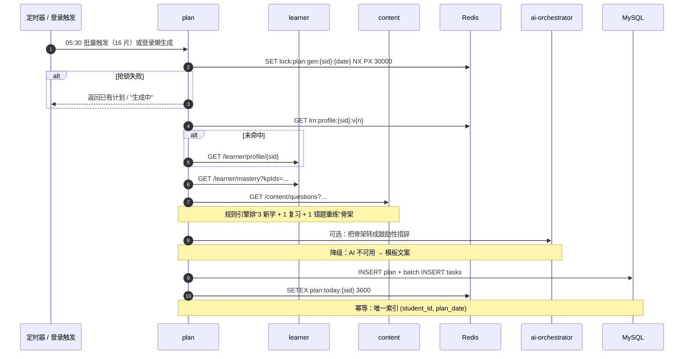
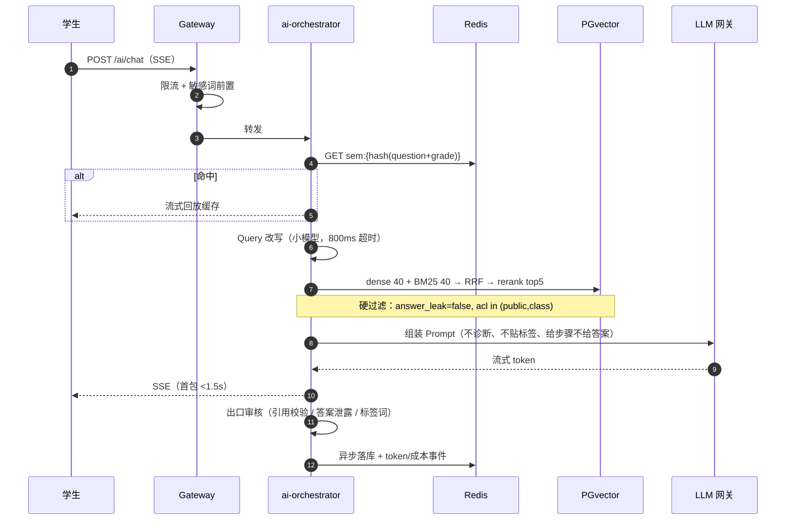
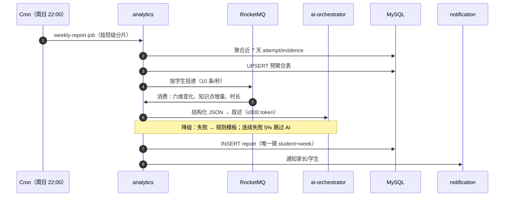

## 5. 技术架构：为 5 人 10 周设计，为 10 万 DAU 留缝

> 这一章要同时回答两个问题：
> **① 10 周内 3–5 人能不能跑起来？② 这套东西能不能体现 skill.txt 里的工程能力？**
> 答案是：**MVP 只跑 4 个部署单元，但边界、契约、数据所有权、拆分触发条件全部按 9 个服务设计。**
> 不为了微服务而微服务，也不为了省事把边界揉成一团。

### 5.1 五条架构原则

| # | 原则 | 具体含义 | 反模式 |
|---|---|---|---|
| P1 | **领域优先，演进式拆分** | 先按限界上下文划清数据所有权，再决定物理部署单元；MVP 4 个单元，目标 9 个服务 | 一上来 9 个库、9 套流水线，5 个人被运维拖死 |
| P2 | **读多写少，缓存前置** | 读写比约 12:1；默认 Caffeine → Redis → MySQL；热点读接口必须给缓存键与失效策略 | 所有请求直打 DB，再用"加机器"掩盖 |
| P3 | **AI 可降级，不是硬依赖** | 所有 LLM 调用经 `ai-orchestrator` → LLM 网关；规则模板兜底，模型挂了闭环仍能跑 | 业务服务直连模型 SDK，模型一挂全站 500 |
| P4 | **证据链不可变，结论可解释** | 作答、画像变更、归因、处方全部 append-only；每个结论可回溯到题、规则、模型版本 | 原地 UPDATE 画像，出了问题无法复盘 |
| P5 | **可观测性即功能** | traceId 从网关贯穿到 SQL 与 LLM span；token/成本/首包延迟与 QPS 同级纳入 SLO | 上线后才补日志，LLM 成本失控 |

### 5.2 目标架构（9 个服务）



**九个服务的职责与拆分理由**：

| 服务 | 职责 | 为什么独立 | 数据所有权 |
|---|---|---|---|
| **gateway** | 统一入口、JWT、限流、灰度、SSE 透传 | 所有流量必经；独立做安全与灰度 | 无（Redis 限流计数） |
| **auth** | 登录、RBAC、家长绑定、监护人同意 | 合规边界独立；被所有端复用 | `t_student`、`t_account`、`t_guardian_rel` |
| **learner** | 六维 + 元认知画像、掌握度、画像版本 | 读多写少，缓存收益最高；画像变更需独立审计 | `t_cognitive_profile`、`t_kp_mastery` |
| **assessment** | 诊断组卷、作答采集、判分、归因 | 晚高峰明显，需独立扩缩容；判分逻辑变更频繁 | `t_assessment_session`、`t_attempt_event`、`t_task_analysis` |
| **content** | 题库、知识点树、材料、版本 | 教研周更；极读多；可独立缓存与 CDN | `t_question`、`t_question_kp`、`t_knowledge_point` |
| **plan** | 处方、每日计划、FSRS 调度、考试冲刺 | 定时峰值；策略双周更；需独立发布 | `t_learning_plan`、`t_plan_task`、`t_prescription` |
| **ai-orchestrator** | RAG、Agent 编排、MCP、护栏 | 资源画像特殊（IO 密集 + 长连接）；成本中心，需独立限流 | 会话表 + 读 PGvector |
| **analytics** | 证据聚合、周报、班级看板 | 批处理型，夜间弹性；不影响在线链路 | `t_weekly_report`、汇总表 |
| **notification/admin** | 推送、审核队列、配置 | 低频；但与内容发布、合规审计绑定 | `t_notification`、`t_audit_log` |

**一条比拆分更重要的纪律**：**每张表只有一个写 owner**。`t_attempt_event` 只由 assessment 写，learner 只读；跨服务禁止直连他人库，一律 OpenFeign 或订阅 MQ。

### 5.3 MVP 落地架构（4 个部署单元）

10 周内不跑 9 个服务，跑 4 个：

| 部署单元 | 合并的模块 | 理由 | 资源画像 |
|---|---|---|---|
| `synapse-gateway` | gateway | 独立不变 | 无状态，2 副本 |
| `synapse-core` | auth + learner + assessment + plan + notification | 共享学生/画像上下文；减少 6 次 RPC；同一事务域 | CPU 中等，4–8 副本 |
| `synapse-content` | content + 题目检索 | 组卷强依赖题库与知识点树；本地调用 P99 从 120ms 降到 30ms | 极读多，4–8 副本 |
| `synapse-ai` | ai-orchestrator + RAG + Agent + MCP | IO 密集 + 长连接；独立限流与成本核算 | 内存/连接密集，2–6 副本 |

`analytics` 先作为 `synapse-core` 里的模块 + 独立定时任务；周报 PDF 走 Serverless。`notification` 先做站内信，微信模板消息 Phase 2。

**合并部署、分离代码**：每个模块只暴露 `api` 包的接口，模块间禁止直接调 Mapper；用 ArchUnit 单测强制依赖方向。**否则合并期就是边界腐化的开始。**

**拆分触发条件**（写进 ADR，任一满足即拆）：

1. 单服务日均调用 > 200 万；
2. 独立发布频率 > 2 次/周；
3. 资源画像差异 > 3 倍（CPU/内存/连接数）；
4. 故障域需要隔离（如 AI 超时不能拖垮判分）。

按 10 万 DAU 估算，`assessment`、`content`、`ai-orchestrator` 会先触发；`analytics` 在周报批处理压垮 DB 时拆。


*图 5-1：MVP 的 4 个部署单元与目标的 9 个服务。边界先立，进程后拆；拆分有触发条件。*

### 5.4 四条关键链路

#### 5.4.1 轻诊断



**关键设计**：作答先写 Redis Hash，提交时批量落库，18 次写变 1 次；MySQL 写入量降约 85%。**降级点**：组卷缓存不可用 → 分层随机抽样；画像重算失败 → 保留旧版本 + `stale=true`。

#### 5.4.2 每日计划生成



**取舍**：**规则定骨架，LLM 只做措辞**。让 LLM 决定"学什么"不可解释、不可回归测试，也无法向家长解释。骨架可 A/B、可测试；LLM 只负责表达。

#### 5.4.3 RAG 问答



**答案单向阀（四道闸）**：
1. 索引期：`chunk_type=answer` 单独 ACL，学生会话强制过滤；
2. 检索期：`answer_leak=false` 硬过滤，不靠提示词；
3. 生成期：输出 schema 只有 `hints[]`，没有 `solution`；
4. 出口期：候选输出与 answer chunk 的 5-gram 重合 >0.6 即拦截重写；提交作答后才允许"对答案模式"。

#### 5.4.4 周报生成



**断点续跑**：job 进度写 Redis，失败从 checkpoint 继续；PDF 渲染走 Serverless，按需触发。

### 5.5 数据设计

#### 5.5.1 核心表（14 张 + 4 张支撑表）

分库：`synapse_core`（auth/learner/plan/assessment）、`synapse_content`、`synapse_ai`、`synapse_ops`。大表按 `student_id` 取模 16 片，单表目标 <2000 万行。**MVP 单库 + 月度分区；分片配置就绪但不路由。**

| # | 表 | 作用 | 关键字段 | 索引 | 分片 |
|---|---|---|---|---|---|
| 1 | `t_student` | 学生主档 | id, phone_enc, nickname, grade, region, status | PK, uk_phone_hash, idx_grade_status | 否 |
| 2 | `t_account` | 账号/凭证 | id, student_id, login_type, credential_hash | uk_type_openid, idx_student | 否 |
| 3 | `t_guardian_rel` | 家长绑定/同意 | id, student_id, guardian_id, relation, consent_ver, consent_at | uk_stu_gua, idx_guardian | 否 |
| 4 | `t_cognitive_profile` | 六维+元认知版本快照 | id, student_id, ver, verbal, perceptual, fluid, wm, speed, lts, metacog, confidence, narrative, created_at | uk_stu_ver, idx_stu_created | 16 片，append-only |
| 5 | `t_knowledge_point` | 知识点树 | id, parent_id, subject, name, level, path, weight | PK, idx_parent, idx_subject_level | 否（<5000 行） |
| 6 | `t_question` | 题库 | id, subject, stem, type, difficulty, answer_enc, analysis, kp_ids, status, use_count | PK, idx_subj_status_diff, idx_kp_ids | 按 subject 分区 |
| 7 | `t_question_kp` | 题目-知识点 | question_id, kp_id, weight | PK(q,kp), idx_kp(kp,q) | 随题 |
| 8 | `t_assessment_session` | 测评会话 | id, student_id, blueprint_id, mode, status, score_json, started_at, submitted_at | PK, idx_stu_time, idx_status | 16 片 |
| 9 | `t_attempt_event` | 原始作答事件（最大表） | id, session_id, student_id, question_id, answer, correct, cost_ms, hint_level, confidence_pre, err_type, mode, created_at | PK, idx_stu_time, idx_sess, idx_q_correct | 32 片 + 月分区 |
| 10 | `t_task_analysis` | 任务解剖结果 | id, attempt_id, student_id, demand_json, bottleneck, confidence, evidence_json, rule_id, model_version, prompt_hash | PK, idx_attempt, idx_stu_created | 16 片 |
| 11 | `t_prescription` | 处方 | id, student_id, bottleneck, protocol_ids, dosage_json, success_criteria, status, start_at, end_at, outcome_json | PK, idx_stu_status_time | 16 片 |
| 12 | `t_learning_plan` / `t_plan_task` | 计划/任务 | plan: id, student_id, plan_date, source, status；task: id, plan_id, type, ref_id, est_min, priority, status | uk_stu_date；idx_stu_date_status_pri | 16 片 |
| 13 | `t_evidence` | 错题/掌握聚合 | id, student_id, question_id, kp_id, err_type, wrong_count, mastered, last_wrong_at | PK, idx_stu_kp_mastered_time | 16 片 |
| 14 | `t_weekly_report` | 周报 | id, student_id, iso_week, metrics_json, narrative, pdf_url, status | uk_stu_week, idx_week_status | 16 片 |
| 15 | `t_ai_conversation` / `t_ai_message` | 会话 | id, student_id, scene, created_at；msg: conv_id, role, content_enc, citations, token_in, token_out | PK, idx_stu_time | 按 conv 哈希 |
| 16 | `t_llm_usage` | 成本核算 | id, scene, model, token_in, token_out, cost, cache_hit, trace_id, created_at | idx_scene_time, idx_model_time | 月分区 |
| 17 | `t_audit_log` | 审计 | id, actor, role, object, action, before_hash, after_hash, ip, ua, trace_id, ts | idx_actor_time, idx_object | 月分区，只增不删 |
| 18 | `t_outbox` | 事务消息 | id, aggregate, event_type, payload, status, retry | idx_status_retry | 否 |

#### 5.5.2 三条关键 SQL 的索引设计

**① 今日任务（最高频，QPS 占比约 18%）**

```sql
SELECT id, task_type, ref_id, est_min, priority, status
FROM t_plan_task
WHERE student_id = ? AND plan_date = ? AND status IN (0,1)
ORDER BY priority DESC, id ASC
LIMIT 20;
```

索引：`idx_stu_date_status_pri (student_id, plan_date, status, priority, id)`。`status IN` 走索引后仍需排序，把 `priority` 放进索引消除 `Using filesort`；`id` 兜底保证稳定排序。分片键与查询条件一致，路由单库，无跨片聚合。

**② 错题本按知识点（QPS 占比约 9%）**

```sql
SELECT id, question_id, kp_id, wrong_count, last_wrong_at
FROM t_evidence
WHERE student_id = ? AND kp_id = ? AND mastered = 0
ORDER BY last_wrong_at DESC
LIMIT 20;
```

索引：`idx_stu_kp_mastered_time (student_id, kp_id, mastered, last_wrong_at DESC)`。四列全等值 + 有序，扫描行数 ≤20。**禁止写 `mastered != 1`**，会导致索引失效。

**③ 组卷取题（低频但走大表，最易慢查询）**

```sql
SELECT q.id, q.stem, q.difficulty
FROM t_question_kp qk
JOIN t_question q ON q.id = qk.question_id
WHERE qk.kp_id = ? AND q.subject = 'MATH' AND q.status = 1
  AND q.difficulty BETWEEN ? AND ?
ORDER BY q.use_count ASC, q.id
LIMIT 10;
```

索引：`t_question_kp (kp_id, question_id)` 覆盖索引驱动；`t_question idx_subj_status_diff (subject, status, difficulty, use_count)` 过滤后 PK 回表。**禁止在 `t_question` 上做全表 `ORDER BY use_count`**——改为应用层对候选 200 条内存排序；`use_count` 每 5 分钟批量 +1，避免热点行锁。

**SQL 纪律**：Druid `StatFilter` + `logSlowSql=true`（阈值 500ms）；每周导出慢 SQL Top20 做 `EXPLAIN` 复核；禁止 `SELECT *`、禁止三表以上 JOIN；深分页一律 keyset（`WHERE id > ? ORDER BY id LIMIT ?`）。

#### 5.5.3 PGvector 与混合检索

```sql
CREATE TABLE kb_chunk (
  id           bigserial PRIMARY KEY,
  doc_id       bigint       NOT NULL,
  chunk_no     int          NOT NULL,
  subject      varchar(16)  NOT NULL,
  grade_band   varchar(8)   NOT NULL,      -- G10/G11/G12
  content      text         NOT NULL,
  token_cnt    int          NOT NULL,
  meta         jsonb        NOT NULL DEFAULT '{}',
  tsv          tsvector     GENERATED ALWAYS AS (to_tsvector('simple', content)) STORED,
  embedding    vector(1024) NOT NULL,
  created_at   timestamptz  NOT NULL DEFAULT now()
);
CREATE INDEX idx_kb_hnsw ON kb_chunk USING hnsw (embedding vector_cosine_ops)
  WITH (m = 16, ef_construction = 200);
CREATE INDEX idx_kb_tsv ON kb_chunk USING gin (tsv);
CREATE INDEX idx_kb_scope ON kb_chunk (subject, grade_band);
```

- 向量模型：`bge-m3`（1024 维，dense + sparse），中文数学术语用 300 条领域对做对比微调。
- HNSW：`m=16` 在 500 万 chunk 规模下 recall@10 约 0.94；`ef_search=80`；千万级改 `halfvec(1024)`，内存约减半。
- 切分：结构感知，480 token / overlap 72；按"定义—定理—例题—易错"打 `chunk_type`；答案 chunk 单独 ACL。
- 混合：dense 40 + BM25 40 → RRF → rerank top5 → 阈值 0.35；长尾知识点走 `kp_codes` 精确匹配 + 向量双通道。
- **答案不喂学生**：`answer_leak` + `acl_level` 是检索期硬过滤字段，不是提示词约束。

#### 5.5.4 Redis / Caffeine / 锁 / 缓存三防

**Redis 五类 key**：

| 类别 | 模式 | 示例 | TTL |
|---|---|---|---|
| 鉴权 | `auth:{type}:{id}` | `auth:token:{jti}` | 2h |
| 实体 | `{svc}:{entity}:{id}:v{ver}` | `cnt:question:1024`、`lrn:profile:88:v3` | 2h / 30min |
| 统计 | `stat:{dim}:{id}:{win}` | `stat:kp:88:2301` | 1h |
| 锁/幂等 | `lock:{biz}:{key}`、`idem:{reqId}` | `lock:plan:gen:88:2026-03-02` | 30s / 10min |
| 限流/过滤 | `rl:{dim}:{id}`、`bf:{entity}` | `rl:llm:88`、`bf:question` | 1h / 永久 |

**Caffeine**：知识点树（<5000 节点，5min）、题目元数据（2 万条，10min）、Prompt 模板与量表（10min）、配置开关（30s）。多副本一致性用 Redis Pub/Sub 广播失效，最大不一致 <200ms；强一致场景只走 Redis。

**三把分布式锁**：

| 场景 | Key | 参数 | 抢锁失败 |
|---|---|---|---|
| 每日计划生成 | `lock:plan:gen:{sid}:{date}` | wait 0，lease 30s，看门狗 | 返回已有计划 |
| 周报生成 | `lock:report:weekly:{sid}:{isoWeek}` | wait 0，lease 60s | 丢弃，MQ 重投 |
| 题库导入/知识树重建 | `lock:content:kp:rebuild` | wait 3s，lease 300s | 409 "已有导入任务" |

锁必须带 owner UUID，Lua 比对释放；**主从切换可能双持有**，幂等操作靠唯一索引兜底。

**缓存三防**：
- **穿透**：布隆过滤器（100 万容量、0.1% 误判、每日重建）+ 空值缓存 60s + 参数正则校验。
- **击穿**：逻辑过期（value 内嵌 `expireAt`，先返回旧值，异步单线程重建）+ Redisson 互斥锁。
- **雪崩**：TTL 随机抖动 `base + rand(0, 10%)` + 每日 05:00 预热 Top5000 + 哨兵/Cluster + Sentinel 熔断降级到 Caffeine 旧值。

**目标**：`content` 缓存命中率 ≥92%，Redis P99 <3ms，DB 回源峰值 <800 QPS。

### 5.6 可观测性

#### 5.6.1 指标

| 层 | 指标 | 目标 |
|---|---|---|
| HTTP | QPS、P50/P95/P99、5xx 率 | P99 <800ms（核心接口） |
| JVM | 堆/非堆、GC 次数与停顿、线程数 | G1 P99 <100ms |
| DB | 连接池、慢 SQL、TPS、主从延迟 | 慢 SQL <20 条/分钟；延迟 <3s |
| 缓存 | 命中率、Redis P99、大 key | 命中率 ≥92%；P99 <3ms |
| MQ | 生产/消费 TPS、堆积、死信 | lag <10000 |
| LLM | TTFT、总延迟、token、单次成本、缓存命中、降级率、拦截率 | TTFT P95 <1.5s；单次 <¥0.05 |

#### 5.6.2 Trace

网关生成 W3C `traceparent`，透传 `X-Trace-Id`、`X-Student-Id-Hash`；Feign 拦截器注入；MyBatis 拦截器为每条 SQL 建 span（参数脱敏）；LLM 调用 span 记录 `llm.model`、`prompt_version`、`input_tokens`、`output_tokens`、`cost`、`cache_hit`、`finish_reason`。采样：错误全采、慢请求全采、正常 10%。

#### 5.6.3 三张 Grafana 大盘 + 五条 SLO

1. **业务大盘**：DAU/WAU、诊断完成率、处方完成率、RAG 问答量、周报成功率、六维分布、漏斗。
2. **服务健康**：QPS/P99/错误率、JVM、DB、Redis、MQ、HPA 副本。
3. **AI 成本与质量**：token（按 scene/model）、日成本/预算、TTFT、降级率、缓存命中、拦截率、Top 慢问题。

| # | SLO | 告警 |
|---|---|---|
| 1 | 核心接口可用性 99.9% | 5xx >1% 持续 5min，P1 |
| 2 | 核心接口 P99 <800ms | P99 >800ms 持续 10min，P2 |
| 3 | AI TTFT P95 <1.5s，失败率 <3% | TTFT >3s 或失败 >5%，P1 |
| 4 | DB 慢 SQL <20/min，主从延迟 <3s | 超阈值，P2 |
| 5 | 周报 2 小时内完成率 100% | MQ lag >10000 或 job 超时，P2 |

**成本告警**：单日 LLM 成本 >预算 120% → P2，并自动把非核心场景切低价模型。

### 5.7 部署与交付

| 环境 | 方案 |
|---|---|
| 本地 | Docker Compose：MySQL、Redis、PG+pgvector、Nacos、RocketMQ、MinIO、Prometheus、Grafana、Loki、4 个应用容器；`make up` 一条命令 |
| 1k DAU | 2 台 ECS + Docker Compose + Nginx，够用且便宜 |
| 1 万 DAU | 托管 K8s（ACK），`synapse-prod` / `synapse-gray` 两个命名空间，HPA，readiness/liveness 分离 |
| 批处理 | 周报 PDF、题库导入、PDF 解析走函数计算 FC，按事件触发，白天缩到 0 |

**Nginx 要点**：TLS 1.3 + HSTS；gzip/brotli；`upstream keepalive 64`；SSE 路径必须 `proxy_buffering off; proxy_cache off; proxy_read_timeout 300s; add_header X-Accel-Buffering no;`；`/api/auth/*` 10r/s 限流；`client_max_body_size 20m`。

**CI/CD**：编译（Spotless + Checkstyle）→ 单测（≥60%，核心域 ≥80%）→ 多阶段镜像（非 root）→ Trivy 扫描（高危阻断）→ 灰度 5%→25%→100% → 冒烟 10 条 → 全量。镜像 tag 用 `git-sha`，禁止 `latest`。数据库变更"先加后删"两阶段，禁止 destructive migration 与灰度同批。

**配置与密钥**：Nacos 按 namespace 隔离；敏感项 AES-GCM + KMS；LLM Key / DB 口令走 K8s Secret；90 天轮换，双 Key 并行。

### 5.8 容量与成本估算

假设：人均 40 次请求/日，晚高峰 19:00–22:00 占 40%，峰值系数 1.5；人均 15 次作答、0.3 次 AI 深度问答。

| 指标 | 1k DAU | 1 万 DAU | 10 万 DAU |
|---|---|---|---|
| 日请求 | 4 万 | 40 万 | 400 万 |
| 峰值 QPS | ~5 | ~50 | ~500 |
| 应用副本 | 2–4 | 8–12 | 30–40 |
| MySQL | 2C8G 单机 | 4C16G 主从 | 8C32G × 4 库 × 16 片 |
| Redis | 1G 单节点 | 4G 哨兵 | Cluster 3 主 3 从，16G |
| PGvector chunk | 5 万 | 50 万 | 500 万（halfvec） |
| LLM 调用/日 | 300 | 3,000 | 30,000 |
| token/日 | 69 万 | 690 万 | 6,900 万 |
| LLM 成本/日（估算） | ¥4 | ¥40 | ¥400 |
| 基础设施/月 | ≈¥1,500 | ≈¥6,000 | ≈¥40,000 |

**瓶颈与扩展顺序**：① 缓存（画像/知识点/题目/语义）→ ② 无状态服务横向扩容 → ③ MQ 削峰 + 批量落库 → ④ 分库分表（`t_attempt_event`、`t_evidence` 先分）→ ⑤ 向量分区/独立向量库 → ⑥ 语义缓存 + 小模型分流（单次成本压到 ¥0.008）→ ⑦ 读写分离/CDN。

**最大风险**：LLM 成本随 DAU 线性增长。必须在 1 万 DAU 前把语义缓存与多模型路由做完，否则 10 万 DAU 时毛利被吃光。

### 5.9 安全与合规

| 领域 | 措施 |
|---|---|
| PIPL | 数据分级（L1 公开题 / L2 学习行为 / L3 个人信息 / L4 未成年人敏感）；最小必要；同意版本化、可撤回；删除 30 天内完成 |
| 未成年人 | 14–18 岁按未成年人处理：监护人手机验证 + 明示同意；22:00–06:00 关闭对话与推送；单日 >120 分钟强提醒；不做摄像头/麦克风监测 |
| 边界 | 不测 IQ、不做医学/心理诊断、不筛查 ADHD/阅读障碍；AI 输出过滤自伤、医疗、绝对化标签 |
| RBAC | student / parent / teacher / admin / ops；权限到 `resource:action`；家长只看绑定孩子；教师只看所带班级；后台写操作二次确认 + 理由 |
| 加密 | 手机号/姓名 AES-GCM，KMS 管密钥，DEK 季度轮换；展示层脱敏；导出报表水印 + 24h 签名 URL |
| 审计 | `t_audit_log` 只增不删，月分区，保留 3 年；独立只读账号；应用账号无 DELETE 权限 |
| LLM 数据 | 境内合规模型；送模型前 PII 脱敏（姓名→学生A、学校→某中学）；只送题目文本 + 匿名画像标签；不送全量对话；开启"不用于训练"；会话保留 180 天可删 |

**一句话红线**：**不测智商、不下诊断、不排名、不出境、不承诺分数。**

### 5.10 这一章如何体现 skill.txt

| skill.txt | 落点 | 可演示证据 |
|---|---|---|
| Java/Python/Go、Hutool/Lombok | Java 21 主栈；Python ETL/评测；Go 事件采集 sidecar；Hutool `TreeUtil`/AES/周计算；Lombok 全量 | `etl/`、`eval/`、`collector/` 目录；Spotless/Checkstyle 门禁；覆盖率报告 |
| Spring Cloud 微服务 | Gateway + Nacos + OpenFeign + Sentinel；4 单元 → 9 服务 ADR | 部署清单、Feign 契约、Nacos 快照、拆分 ADR、灰度记录 |
| MySQL / 分表 / Druid | 14 张核心表；`student_id` 16 片；3 条 SQL 索引优化；慢 SQL 日报 | `schema.sql`、`sharding-config.yaml`、EXPLAIN 对比、Druid 报表 |
| Redis / Caffeine / 锁 / 三防 | 三级缓存、5 类 key、3 把锁、布隆/逻辑过期/随机 TTL/哨兵 | Grafana 命中率、锁配置、故障演练记录 |
| Docker / Nginx / Serverless | 多阶段镜像、Compose、SSE 配置、FC 周报 PDF | `Dockerfile`、`docker-compose.yml`、`nginx.conf`、FC 日志 |
| Prometheus / Grafana / ARMS | 六类指标、全链路 Trace、三张大盘、5 条 SLO | 大盘 JSON、告警规则、Trace 截图（含 LLM span） |
| SEO / GEO | 能力百科 SSR、TDK、JSON-LD、llms.txt、AI 引用监测 | 页面 URL、Rich Results 校验、Search Console 曲线 |

> 详细的逐条映射与面试讲法见第 9 章。