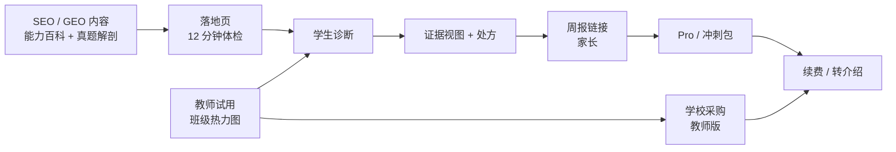

## 7. 增长与商业化：先让教师愿意用，再让家长愿意付

> 这类产品最容易犯的错误，是把"科学"当获客卖点。
> 家长不为"脑科学"付费，家长为"我孩子的具体问题被说清楚了"付费；教师不为"AI"买单，教师为"少备一节课、讲评更准"买单。
> 所以增长顺序是：**内容被搜到 → 教师课堂用起来 → 学生诊断 → 家长看到周报 → 付费。**

### 7.1 市场与切入点

**可服务市场（SAM）粗算**：

| 项 | 估算 | 说明 |
|---|---|---|
| 中国普通高中在校生 | ≈2,800 万 | 公开统计量级 |
| 数学为必修 | ≈100% | 高考必考 |
| 愿意为数字学习工具付费的家庭 | 8–12% | 保守假设，参考教辅/网课渗透 |
| 年客单价 | ¥200–300 | Pro 年费 + 冲刺包 |
| SAM | ≈4.5–10 亿元/年 | 2,800 万 × 10% × ¥200 ≈ 5.6 亿 |

**不是一个大市场，但是一个"高痛点、可验证、能守住"的细分市场。** 这比"AI 教育万亿市场"的 PPT 数字更可信，也更容易在面试中讲清楚。

**切入点**：高中数学"函数与导数"——高考必考、区分度高、家长感知强、题目可标注性好。首期 300 题、12 个知识点，足以支撑一个完整体验。

**为什么从教师切入**：
- 教师有 45 个学生，是天然的分发节点；
- 教师能提供标注与效度反馈，是冷启动的"专家数据源"；
- 教师愿意为"分层题单 + 讲评脚本"买单，而不是为"AI 聊天"；
- 家长付费决策慢，教师推荐能显著降低信任成本。

### 7.2 增长模型：内容 → 教师 → 学生 → 家长



**三条获客路径**：

| 路径 | 成本 | 速度 | 质量 | 适用阶段 |
|---|---|---|---|---|
| **内容/SEO/GEO** | ¥5–15/注册 | 慢（3–6 个月起量） | 高（意图明确） | 0–12 个月，长期资产 |
| **教师/学校** | ¥20–40/注册 | 中（1 个教师 ≈ 45 学生） | 最高（信任背书） | 3–12 个月 |
| **信息流/达人** | ¥80–150/注册 | 快 | 低（冲动点击） | 验证期小预算，不放量 |

**明确不做**：不做"0 元领资料"的羊毛裂变；不做"邀请 3 人解锁报告"的强制裂变；不做"排名/晒分"的社交传播。它们会污染数据、拉低付费质量、触碰未成年人合规。

### 7.3 SEO / GEO：把教研资产变成自然流量

#### 7.3.1 四类页面

| 类型 | 示例 | 搜索意图 | 转化动作 |
|---|---|---|---|
| **能力百科** | `/ability/working-memory` | "工作记忆 数学 怎么练" | 开始 12 分钟体检 |
| **知识点页** | `/math/derivative/monotonicity` | "导数 单调性 题型" | 看一道真题解剖 |
| **真题解剖** | `/math/derivative/2023-national-1-21` | "2023 新高考一卷 导数 压轴" | 看"卡在哪" |
| **方法论** | `/science/retrieval-practice` | "提取练习 怎么做" | 订阅/开始诊断 |

**每页必须回答一个具体问题，且首屏给答案**。不做"什么是一万小时定律"这类泛流量；只做"高二导数单调性总丢参数范围怎么办"这类长尾高意图。

#### 7.3.2 技术 SEO

- Next.js 14 SSR/ISR；`generateMetadata` 统一 TDK 模板；`hreflang` 暂不做（单语）。
- URL 语义化、扁平（≤3 层）、canonical 自指；分页 `?page=` 加 `noindex` 或 rel prev/next。
- `sitemap.xml` 分片：`/sitemap-ability.xml`、`/sitemap-math.xml`、`/sitemap-blog.xml`；`lastmod` 真实更新。
- 结构化数据：`LearningResource`（知识点/题解）、`FAQPage`（每页 3–5 问）、`HowTo`（方法步骤）、`Article`（博客）、`BreadcrumbList`。
- 性能：LCP <2.5s、CLS <0.1、INP <200ms；图片 AVIF/WebP + 尺寸声明；字体子集化。
- 内链：hub-and-spoke——能力百科 → 知识点 → 真题 → 方法；每页 3–6 条上下文内链，不做页脚堆链。
- 收录：Search Console + 百度站长 + Bing；提交 sitemap；每周看"已收录/发现未收录/抓取异常"。

#### 7.3.3 GEO（生成式引擎优化）

生成式引擎（DeepSeek、豆包、Kimi、Perplexity、Google AI Overviews）的引用逻辑与经典 SEO 不同：**它更偏好"可抽取的结论 + 可核验的来源 + 结构化的事实"**。

| 做法 | 具体 |
|---|---|
| **答案前置** | 每页前 120 字给结论，再展开论证；不用"本文将……"开头 |
| **事实密度** | 定义、公式、适用条件、反例、常见错误，用表格/列表呈现 |
| **可引用单元** | 每个小节自包含（"什么、为什么、怎么做、什么时候不适用"），便于切块引用 |
| **来源与日期** | 标注教材版本、课标条目、作者、更新时间；不写"研究表明"而无出处 |
| **llms.txt** | 根目录提供 `llms.txt`，列出核心页面、内容边界、引用格式、联系方式 |
| **开放抓取** | `robots.txt` 允许 GPTBot/ClaudeBot/PerplexityBot 等（可配置），不靠"防抓"保内容 |
| **实体一致** | 品牌名、作者、机构、同一知识点的定义在全站一致；Organization/Person schema |
| **监测** | 每月 20 个提示词 × 5 个引擎，记录是否被引用、引用页面、描述是否准确 |

**KPI**：3 个月内 30 页被收录 ≥85%；6 个月自然搜索注册 ≥300/月；AI 引用 ≥20 条/月；内容→注册转化 ≥3%。

**边界**：GEO 是长期内容资产，不是增长杠杆。**不承诺"让 AI 一定推荐你"**——生成式引擎的规则不稳定，把预算全押在上面是赌博。

#### 7.3.4 内容生产流水线

```
教研选题（20 个/月）
  → 大纲（定义/公式/例题/易错/自检）
  → 人工撰写 + 真题标注
  → AI 辅助扩写（只做措辞，不做结论）
  → 学科编辑复核（事实/课标/版权）
  → 结构化数据 + 内链
  → 发布 + Search Console 提交
  → 4 周后看排名/点击/转化，淘汰后 30%
```

**产能**：1 名教研 + 1 名兼职编辑，每月 20–30 页；不追求日更，追求"每页能被打分"。

### 7.4 定价与单位经济

#### 7.4.1 定价

| 档位 | 价格 | 包含 | 目标 |
|---|---|---|---|
| **Free** | ¥0 | 1 次诊断/月、1 次解剖/周、3 题/日、基础周报 | 获客与体验 |
| **Pro** | ¥39/月；¥299/年 | 无限解剖、完整处方、考前冲刺、家长详细周报、错题导出 | 核心付费 |
| **冲刺包** | ¥69/30 天 | 考前 72 小时 + 3 套整卷 + 人工学习计划 1 次 | 季节性 |
| **教师版** | ¥99/月/班（首班免费） | 班级热力图、分层题单、讲评脚本、家长沟通摘要 |  B 端入口 |
| **学校版** | ¥20/学生/年（≥500 人） | 教师版 + 校本题库 + 数据看板 + 培训 | 规模化 |
| **人工解读** | ¥199/次 | 教研 1 对 1 （Phase 2，限量） | 高客单，不做主力 |

**定价逻辑**：锚定"一节线下数学课 ¥150–300"，Pro 年费 ≈ 两节课；冲刺包 ≈ 半节课。**不按"提分"定价，按"节省的时间 + 获得的确定性"定价。**

#### 7.4.2 单位经济（保守估算）

| 项 | 数值 | 说明 |
|---|---|---|
| 混合 CAC | ¥60–90 | 内容 ¥10 + 教师 ¥30 + 信息流 ¥120，按 5:3:2 加权 |
| 付费转化（注册→付费） | 5–8% | 体验后付费，非直接买 |
| Pro 年费 | ¥299 | 早鸟 ¥199 |
| 年 churn | 45–55% | 高中用户 1–2 年生命周期 |
| ARPPU（年） | ¥260 | 含冲刺包/教师版分摊 |
| 毛利率 | 78–85% | LLM 成本约 ¥1.5–3/用户/月，其余为云/支付 |
| LTV | ¥260 × 0.8 / 0.5 ≈ ¥416 | 保守取 ¥350 |
| LTV/CAC | 3.9–5.8 | 目标 ≥3 |
| 回本周期 | 2–4 个月 | 年费一次回本 |

**敏感性**：若转化 3%、CAC ¥120，LTV/CAC ≈1.9，不成立；若 churn 60%，LTV ≈¥208，也不成立。**所以 5% 转化 + ¥90 CAC 是生死线**，不是"增长目标"。

### 7.5 漏斗与北极星指标

**北极星：WAC（Weekly Active Completed Loops）**——一周内完成 ≥1 次"诊断→处方→验证"完整闭环的学生数。它同时约束"拉新、激活、留存、价值"，比 DAU 更难刷。

| 阶段 | 指标 | 10 周目标 | 6 个月目标 |
|---|---|---|---|
| 获取 | 注册 | 1,000 | 10,000 |
| 激活 | 诊断完成率 | ≥70% | ≥72% |
| 激活 | 首日处方完成率 | ≥55% | ≥60% |
| 留存 | D7 | ≥35% | ≥40% |
| 留存 | D30 | ≥18% | ≥22% |
| 价值 | 7 天同型题提升（相对基线） | ≥10pp | ≥12pp |
| 收入 | 付费转化 | ≥5% | ≥7% |
| 推荐 | NPS | ≥30 | ≥35 |

**注意**：10 周 1,000 注册 / 300 WAU 是"验证规模"，不是"增长规模"。**不要用 10 万 DAU 的架构叙事去掩盖 10 周只有 40 个 beta 用户的事实**——这恰恰是可信度的一部分。

### 7.6 三阶段 GTM

| 阶段 | 时间 | 目标 | 动作 | 退出条件 |
|---|---|---|---|---|
| **0 验证** | 0–3 个月 | 40–60 封闭用户 | 3 位教师、1 所学校、每周 2 次访谈；手工标注 + 人工复盘 | 诊断完成率 ≥55%、处方执行 ≥35%、NPS ≥30 |
| **1 种子** | 3–6 个月 | 1,000 注册 / 300 WAU | 30 页内容、教师推荐、邀请码、¥9.9 体验包 | 付费 ≥5%、D7 ≥35%、CAC ≤¥90 |
| **2 增长** | 6–12 个月 | 10,000 注册 / 2,500 WAU | SEO 80 页、50 位教师、学校试点、冲刺季 | LTV/CAC ≥3、毛利率 ≥78% |
| **3 规模** | 12–24 个月 | 100,000 注册 / 20,000 DAU | 学科扩展、区域代理、学校版、内容授权 | 单月盈亏平衡 |

**季节性**：3–6 月（高考冲刺）、9–1 月（学期同步）是旺季；7–8 月做续费与预习；春节前后是低谷。现金流按"两峰一谷"排。

### 7.7 商业化红线

- 不向未成年人直接投放付费广告；付费由监护人完成。
- 不做"不买就落后"的恐吓式营销；不做"提分/提智商"承诺。
- 不做"排名/晒分"社交裂变；不做"拉 3 人解锁"的强制裂变。
- 学校版数据归学校与学生，平台不用于二次营销；合同写明数据边界。
- 所有效果宣传附样本量、周期、对照方式；没有证据就不说。

---

## 8. 实施路线与可行性：先把最脏的活干完

> 这一章回答评审最关心的三个问题：
> **① 10 周到底能做出什么？② 最大的风险是什么？③ 什么情况下应该停？**
> 结论先行：**技术上可行，内容上是瓶颈，商业上需要验证。**
> 最大的风险不是 AI 不够强，而是"300 道题标不完"和"学生不愿意做 12 分钟诊断"。

### 8.1 10 周路线图

| 周 | 主题 | 交付物 | 负责 | 门禁 |
|---|---|---|---|---|
| **W0**（提前 1 周） | 内容先行 | 12 个知识点拆解、300 题入库、双人标注 100 题、κ≥0.75 | 教研 + 全栈 | 没有 300 题不开工 |
| **W1** | 骨架 | 4 个部署单元跑通；登录/诊断会话/题库 API；CI/CD；Compose | 后端 2 | 本地一键起，健康检查通过 |
| **W2** | 诊断 | 24 题蓝图、组卷、作答、判分、规则版报告；埋点 | 后端 + 前端 | 完成率 ≥60%（内部 10 人） |
| **W3** | 证据视图 | 六维粗档、元认知、Top2 瓶颈、证据卡；"我不同意" | 前端 + 算法 | 10 个用户能读懂"卡在哪" |
| **W4** | 处方 | P0/P1/P2/P4/P5；每日 3–9 题；完成/复测 | 后端 + 前端 | 处方执行率 ≥50%（内部） |
| **W5** | 解剖 | 五段模型、行为采集、归因规则、3 个 Agent 上线 | 算法 + AI | 归因与教研一致率 ≥0.7 |
| **W6** | RAG | 教材入库、混合检索、引用、答案单向阀 | AI | 引用准确率 ≥0.9；答案泄露 0 |
| **W7** | 双模式 + 周报 | 考试模式、72 小时冲刺、家长周报链接 | 全栈 | 周报 2 小时内生成 |
| **W8** | 教师 + 内容 | 班级热力图、分层题单、30 页 SEO/GEO | 前端 + 教研 | 3 位教师试用通过 |
| **W9** | 压测 + 可观测 | 500 并发、三张大盘、5 条告警、故障演练 | 后端 | P95 <800ms；缓存命中 ≥85% |
| **W10** | 封闭 beta | 40–60 用户、7 天数据、复盘、定价测试 | 全员 | 三条 kill criteria 全过 |

**并行策略**：W1–W4 后端与前端并行；W5–W6 AI 与内容并行；W7 后全员转向 beta。**每周五 demo，不接受"下周就好了"。**

### 8.2 团队与预算

| 角色 | 人数 | 职责 | 关键能力 |
|---|---|---|---|
| 产品/教研负责人 | 1 | 定位、标注体系、用户访谈、内容 | 懂高中数学，能做双人标注 |
| 后端 | 2 | 4 个单元、数据、缓存、可观测 | Java 21 / Spring Boot / MySQL / Redis |
| 前端 | 1 | 学生端、教师端、周报 | Next.js / SSR / 数据可视化 |
| AI/算法 | 1 | 诊断、归因、RAG、Agent、评测 | Python / Spring AI / 检索 / 评测 |
| 兼职学科教师 | 1–2 | 300 题标注、效度评审、话术 | 5 年以上高中数学 |
| 设计/QA | 0.5 | UI、可用性测试、回归 | 可用性测试经验 |

**总人力**：4.5–5.5 FTE × 10 周 ≈ 45–55 人周。**红队估算 1,750 小时（约 44 人周）**，与这个配置吻合；如果只有 3 人，必须砍到"单知识点 + 12 分钟诊断 + 3 个协议"。

**预算（MVP 10 周）**：

| 项 | 金额 | 说明 |
|---|---|---|
| 人力（机会成本） | ¥30–45 万 | 按 4.5 人 × 10 周 |
| 云与 LLM | ¥1.5–3 万 | 1k DAU 以内，含 embedding/rerank |
| 内容标注 | ¥2–4 万 | 300 题 × 2 人 + 抽检 |
| 设计/法务/合规 | ¥1–2 万 | 隐私政策、未成年人同意书 |
| 种子投放/教师 | ¥1–2 万 | 不投信息流，只做教师与内容 |
| 合计 | ¥35–56 万 | 不含创始人工资 |

**如果预算 <¥15 万**：砍到 1 个知识点、100 题、1 个协议、无教师端；先验证"诊断→处方→复测"是否成立，再谈其他。

### 8.3 可行性评估（分项打分）

| 维度 | 评分（1–5） | 判断 | 依据 | 最大风险 |
|---|---|---|---|---|
| 技术 | 4 | 可行 | 4 个单元、成熟栈、无自研模型；RAG/Agent 有现成框架 | LLM 延迟与成本；多 Agent 调试 |
| 内容 | 2.5 | **瓶颈** | 300 题双人标注 + 12 知识点拆解，是 6–8 周脏活 | 标注一致性；题目效度 |
| 需求 | 3.5 | 有真实痛点 | 错题本/周测反馈粗；家长信息黑箱；教师分层难 | 学生不愿做 12 分钟诊断 |
| 商业 | 3 | 待验证 | 家长有付费意愿，但对"新概念"谨慎；教师是杠杆 | 转化率 <5%；CAC >¥90 |
| 团队 | 3.5 | 匹配 | 4.5 人覆盖前后端/AI/教研；缺全职设计 | 教研与工程协作 |
| 合规 | 3 | 可控 | 不做医学诊断、不做 IQ、境内存储；未成年人同意 | 家长对"能力"敏感；政策变化 |
| **综合** | **3.2/5** | **有条件可行** | 技术不是瓶颈，内容与需求验证是 | 先做内容，再做产品 |

**结论**：这不是一个"技术风险型"项目，而是一个"内容 + 需求验证型"项目。**最该先花的钱是教研标注，不是 GPU。**

### 8.4 风险登记册

| # | 风险 | 概率 | 影响 | 触发信号 | 对策 |
|---|---|---|---|---|---|
| R1 | 300 题标不完/一致性低 | 高 | 高 | W2 结束 κ<0.6 | 缩到 6 个知识点、150 题；先做单知识点 |
| R2 | 诊断完成率 <55% | 中高 | 高 | 内测 <50% | 缩到 12 分钟/18 题；第 6 题先给卡；加"稍后继续" |
| R3 | 学生不执行处方 | 高 | 高 | 7 天执行 <30% | 题量降到 1–3；加家长/教师轻提醒；改"每日 5 分钟" |
| R4 | 归因不可信 | 中 | 高 | 与教研一致 <0.7 | 先做规则 + 人工复核；LLM 只解释；置信 <0.55 不下结论 |
| R5 | LLM 成本/延迟失控 | 中 | 中 | 单用户月成本 >¥5；TTFT >3s | 语义缓存、T1/T2 分流、上下文压缩、降级模板 |
| R6 | 家长不付费 | 中高 | 高 | 体验→付费 <3% | 改卖"教师版/学校版"；先 B 后 C；降低年费门槛 |
| R7 | 政策/合规 | 低中 | 高 | 未成年人数据监管收紧 | 不做医学/IQ；境内；最小化；同意可撤回；法律顾问 |
| R8 | 大厂复制 | 中 | 中 | 题海/教育硬件上线类似功能 | 用"证据链 + 教师工作流 + 标注数据"筑墙；不拼题库规模 |
| R9 | 团队被 9 服务拖垮 | 中 | 中 | W3 还在搭 Nacos | 锁死 4 个单元；拆分放 Phase 2 |
| R10 | 效果不显著 | 中 | 高 | 7 天提升 <5pp | 缩窄到 LTS/M（证据最强）；不承诺 Gf 迁移 |

### 8.5 Kill Criteria（什么情况下停）

10 周 beta 结束，三条同时成立才继续；任一不成立，先修，不扩：

| # | 指标 | 阈值 | 测量 |
|---|---|---|---|
| 1 | 诊断完成率 | ≥55%（目标 70%） | 开始→提交 |
| 2 | 4 周处方执行率 | ≥35%（目标 60%） | 完成任务/分配任务 |
| 3 | 付费意愿 | ¥9.9 体验包转化 ≥5%，或 10 人明确愿付 ¥299/年 | 真实支付/预售 |

**二级门禁（6 个月）**：D7 ≥35%、LTV/CAC ≥3、毛利率 ≥78%、归因一致率 ≥0.8。任一不达标，不扩学科、不投流。

**Pre-mortem（假设 12 个月后失败，最可能的原因）**：
1. 内容标注质量不够，归因像算命，用户流失；
2. 学生不愿做 12 分钟诊断，漏斗在第一屏就漏光；
3. 家长觉得"又是智商测试"，信任建立不起来；
4. 团队把时间花在微服务/多 Agent 上，产品没打磨；
5. 大厂用题库 + 免费策略碾压，获客成本失控。

**对应的"反脆弱"设计**：内容先行、首屏 3 分钟给价值、明确"不测智商"、4 个单元锁死、用教师工作流做差异化。

### 8.6 90 天验证计划

| 阶段 | 时间 | 目标 | 关键动作 | 产出 |
|---|---|---|---|---|
| **P0 内容** | 第 1–3 周 | 单知识点跑通 | 100 题、双人标注、10 个学生手测 | κ、错因分布、完成率 |
| **P1 原型** | 第 4–6 周 | 诊断→处方→复测 | 20 个学生、纸面 + 低保真 | 完成率、执行率、访谈 |
| **P2 MVP** | 第 7–10 周 | 40–60 beta | 4 个单元、3 个 Agent、周报 | 7 天数据、NPS、付费意愿 |
| **P3 决策** | 第 11–12 周 | go / no-go | 复盘、定价、下一阶段计划 | 决策备忘录 |

### 8.7 规模化路径（如果验证通过）

| 阶段 | 时间 | 用户 | 学科 | 架构 | 组织 |
|---|---|---|---|---|---|
| MVP | 0–3 月 | 40–60 | 数学 1 模块 | 4 单元 | 4.5 人 |
| 种子 | 3–6 月 | 1,000 | 数学 3 模块 | 4 单元 + 读副本 | 6 人 |
| 增长 | 6–12 月 | 10,000 | 数学全科 + 物理试点 | 拆 assessment/analytics | 10 人 |
| 规模 | 12–24 月 | 100,000 注册 / 20,000 DAU | 数学 + 物理 + 化学 | 9 服务 + 分片 | 20–25 人 |

**架构按 10 万 DAU 设计，业务按 2 万 DAU 规划**——这是刻意留出的余量，不是 KPI 吹牛。

### 8.8 可行性结论（给评审的一句话）

> 这个项目最难的不是 AI，是**把 300 道题标得连两个老师都同意**，以及**让一个 17 岁的学生在第 6 题后相信"这个系统懂我"**。
> 技术方案已经为这两件事让路：4 个部署单元、规则定骨架、AI 只做解释、诊断 12 分钟、第 6 题给卡。
> 如果这两件事成立，后面的微服务、多 Agent、GEO 都是顺理成章的扩展；如果不成立，再漂亮的架构也只是自嗨。