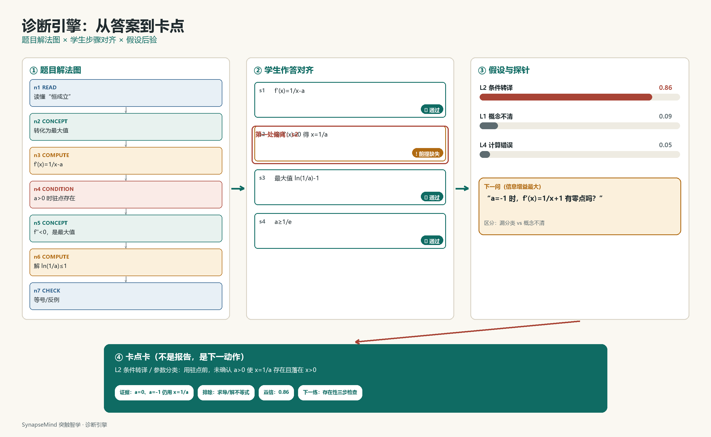

# 诊断引擎

诊断引擎把题目、学生作答与追问放在同一张解法图上。它回答一个问题：在整条解题链中，哪一个认知动作最先失效，证据是什么。

## 解法图

每道题对应一张有向无环图（DAG）。节点是七类可枚举的认知动作，并非解题步骤的流水账：

| 类型 | 含义 | 例子 |
|---|---|---|
| `READ` | 读懂题意、符号与量词 | “对任意 `x>0` 恒成立” |
| `CONCEPT` | 调用定义、定理或公式 | 导数与单调性的关系 |
| `CONDITION` | 把文字条件转成式子、图形或分类 | `a>0` 时才有正驻点 |
| `STRATEGY` | 选择整体路径 | 先分类，再求最值 |
| `TRANSFORM` | 等价变形 | `ln(1/a)≤1` 推出 `a≥1/e` |
| `COMPUTE` | 计算与代数 | 求导、解不等式 |
| `CHECK` | 校验、边界与反例 | 检查 `a=0`、`a<0` |

节点之间用依赖边连接。每个节点记录概念、常见错误与可用的探针模板。

```json
{
  "id": "n4",
  "type": "CONDITION",
  "text": "确认 a>0 时，驻点 x=1/a 才落在定义域 x>0",
  "prerequisites": ["n2"],
  "common_errors": ["E_NOCASE", "E_DOMAIN"]
}
```



## 步骤对齐

学生作答被拆成步骤链，再映射到图节点：

```json
{
  "attempt_id": "A_1024",
  "steps": [
    {"id": "s1", "text": "f'(x)=1/x-a", "maps_to": "n3", "status": "ok"},
    {"id": "s2", "text": "令 f'(x)=0，得 x=1/a", "maps_to": "n4", "status": "partial",
     "evidence": "未说明 a>0；a=0 时除法无意义"},
    {"id": "s3", "text": "最大值 f(1/a)=ln(1/a)-1", "maps_to": "n5", "status": "ok"}
  ]
}
```

对齐分三步：

1. 符号归一化：LaTeX 转 SymPy 表达式，处理对数、分数与区间。
2. 步骤匹配：模型把步骤映射到节点，规则层检查依赖是否满足。
3. 定位断点：从入口向后走，第一个 `missing`、`partial` 或 `wrong`，且其前置节点均通过的位置，就是候选断点。

断点取最早失效的节点，不取最后一个错误。后面的错误可能只是前一步失效后的连带结果。

## 卡点层级

| 层级 | 性质 | 典型信号 | 首个探针 |
|---|---|---|---|
| L0 | 读题与语义 | 把“任意”读成“存在”，不理解符号 | 用自己的话复述条件 |
| L1 | 概念与定理 | 不知道 `f'(x)=0` 只是必要条件 | 遮住公式，写出适用条件 |
| L2 | 条件转译 | 漏参数分类、漏定义域、边界未检查 | 令 `a=0`，原式是否成立 |
| L3 | 策略 | 知识点都会，但不知道先做什么 | 只允许走一步，选哪一步 |
| L4 | 执行 | 策略正确，计算或符号出错 | 只检查这一步的符号 |
| L5 | 校验与元认知 | 不检查边界，自信与正确率背离 | 估计这题的正确概率并说明依据 |
| L6 | 资源与状态 | 时间不足、焦虑、注意力下降 | 不计时，只做第一步 |

定层至少需要两个独立信号。能落到具体节点时，不只给层位。L6 不进入教学内容，只做降难度或休息建议。任何层级都不使用“笨”“懒”“不认真”一类标签。

## 假设与探针

系统维护一个小假设集，通常 2–3 个候选：

```json
{
  "session_id": "S_9001",
  "candidates": [
    {"hypothesis": "H_L2_CASE", "label": "漏参数分类", "prior": 0.42, "posterior": 0.42},
    {"hypothesis": "H_L1_DERIV", "label": "导数与极值概念不清", "prior": 0.25, "posterior": 0.25},
    {"hypothesis": "H_L4_CALC", "label": "解不等式计算错误", "prior": 0.18, "posterior": 0.18}
  ]
}
```

先验来自题目节点的常见错误、学生自述、历史记录（若存在）以及初步对齐结果。

探针预先标注它能区分哪些假设：

| 类型 | 例子 | 主要区分 |
|---|---|---|
| 反例 | `a=-1` 时，`f(x)` 会不会超过 0 | L2 分类与 L1 概念 |
| 定义域检查 | `x=1/a` 在 `a<0` 时是什么符号 | L2 条件转译与 L4 计算 |
| 解释步骤 | 为什么 `f'(x)=0` 能说明是最大值 | L1 概念与 L3 策略 |
| 下一步 | 只允许走一步，走哪步 | L3 策略与 L4 执行 |
| 信心校准 | 这题能对几成，为什么 | L5 元认知 |
| 提取 | 遮住公式，写出 `(ln x)'` | L1 与长时存取 |

选择规则：

1. 只在排名前 2–3 的假设之间选择。
2. 优先选择预期信息增益最大的探针。
3. 同一探针无法区分两个假设时，换一个。
4. 一轮只问一个问题；连续两次“不知道”后，降级为二选一、具体数值或半成品填空。

## 置信度与停止

置信度用对数几率更新：

```text
logit(H_i | e) = logit(H_i) + log LR(e | H_i)
```

每个探针返回离散结果，对应预设似然比：

| 探针结果 | H_L2 分类 | H_L1 概念 | H_L4 计算 |
|---|---:|---:|---:|
| 能判断 `a=0` 不成立，但未主动分类 | ×3.0 | ×0.8 | ×1.0 |
| 认为 `a<0` 时仍有最大值 | ×0.4 | ×2.5 | ×0.6 |
| 计算 `ln(1/a)≤1` 出错 | ×0.8 | ×0.7 | ×4.0 |

满足任一条件即停止：

- 最高后验 ≥0.80，且与第二名差距 ≥0.25；
- 已问 6 轮；
- 连续两次“不知道”，降级后仍无法判断；
- 学生要求直接给出答案。

后验与展示口径：

| 后验 | 文案 | 行为 |
|---|---|---|
| ≥0.80 | 比较确定 | 卡点卡 + 微干预 |
| 0.55–0.79 | 倾向于 | 卡点卡 + 一个验证问题 |
| <0.55 | 尚不能确定 | 列出 2–3 个可能，继续问或让学生选择 |

## 诊断卡

诊断卡固定六块：

1. 卡点：层位与具体节点。
2. 证据：引用学生的原话或步骤。
3. 排除：明确说明哪些竞争假设被排除。
4. 置信度：高、中、低，附后验数字。
5. 下一步：三分钟内可完成的一个动作。
6. 验证：24 小时或 7 天后的一道新题。

不合格的写法是：“你的函数与导数基础薄弱，建议加强练习。”这是标签，没有证据、排除项和下一步。

## 失败与降级

| 失败 | 表现 | 降级 |
|---|---|---|
| OCR 错误 | 公式识别成其他内容 | 让学生确认或手改关键符号 |
| 解法图缺失 | 新题不在标注库 | 现场生成图并过 schema 与结构规则；标记探索模式，置信度上限 0.65 |
| 多个卡点 | 同时缺概念与计算 | 只取最早断点，其余记入后续观察 |
| 学生拒绝回答 | 只想要答案 | 提供退出学习模式的入口；该次会话不生成卡点卡 |
| 情绪风险 | 焦虑或自我否定 | 停止追问，建议休息或寻求教师帮助 |
| 答案泄漏 | 模型试图给出完整解 | 出口过滤器拦截并改写为提示，记录 `answer_leak` |

## 完整示例

仍以 `f(x)=ln x - a x` 为例：

```text
n1 READ      读懂“对任意 x>0，f(x)≤0 恒成立”
n2 CONCEPT   知道需要研究 f 的最大值
n3 COMPUTE   求导 f'(x)=1/x-a
n4 CONDITION 分 a≤0 / a>0；确认 a>0 时驻点 x=1/a 在定义域
n5 CONCEPT   a>0 时 f''<0，x=1/a 是最大值
n6 COMPUTE   解 ln(1/a)-1≤0
n7 CHECK     验证 a=1/e 时等号成立；a<1/e 时给出反例
```

依赖链为 `n1→n2→n3→n4→n5→n6→n7`。学生过程对齐后，`n4` 为 `partial`，`n1–n3` 通过，`n5–n7` 的结果虽正确，但建立在未验证的前提上。根因是 `n4`，不是 `n6`。

错在结果，卡在前提。诊断卡只对最早断点负责。