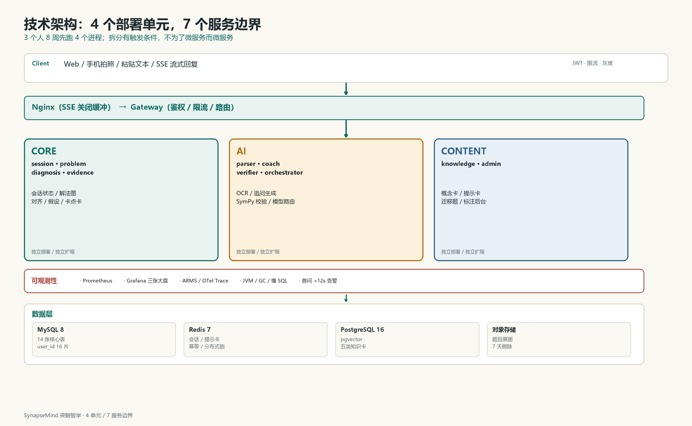

## 7. 技术架构：为“一次对话”设计，不为“大平台”设计

### 7.1 四个部署单元，七个服务边界

MVP 只跑 4 个进程，避免 3 个人被 Nacos/K8s 拖死；但边界按 7 个服务设计，后续可拆。

| 部署单元 | 包含的服务边界 | 职责 |
|---|---|---|
| **gateway** | API Gateway | 鉴权、限流、SSE 转发、灰度 |
| **core** | session、problem、diagnosis、evidence | 会话、题目图、对齐、假设、诊断卡 |
| **ai** | ai-orchestrator、parser、coach、verifier | OCR、LLM 调用、追问生成、校验 |
| **content** | knowledge、content-admin | 知识库、提示卡、迁移题、标注后台 |

目标 7 服务：

```text
gateway
session-service
problem-service
diagnosis-service
knowledge-service
evidence-service
ai-orchestrator
```

拆分触发（写进 ADR，不拍脑袋）：

- 日均诊断 > 20 万次；
- AI 调用与业务事务的资源画像差 > 3 倍；
- 周发布 > 2 次且互相阻塞；
- 故障域需要隔离（AI 挂了，诊断卡仍可出）。



*图 7-1 4 个部署单元、7 个服务边界；MySQL/Redis/pgvector 数据层；可观测性横贯全链路。*

### 7.2 核心表

| # | 表 | 作用 | 关键字段 | 索引 |
|---|---|---|---|---|
| 1 | `t_user` | 用户 | `id`, `grade`, `status` | PK |
| 2 | `t_problem` | 题目 | `id`, `subject`, `stem`, `answer_hash`, `graph_id` | `(subject, graph_id)` |
| 3 | `t_solution_node` | 解法图节点 | `id`, `problem_id`, `type`, `demand_json`, `prereq` | `(problem_id, type)` |
| 4 | `t_attempt` | 一次作答 | `id`, `user_id`, `problem_id`, `source`, `created_at` | `(user_id, created_at)` |
| 5 | `t_attempt_step` | 作答步骤 | `id`, `attempt_id`, `seq`, `latex`, `maps_to`, `status` | `(attempt_id, seq)` |
| 6 | `t_dialogue_session` | 诊断会话 | `id`, `attempt_id`, `state`, `turn_count`, `mode` | `(attempt_id)` |
| 7 | `t_dialogue_turn` | 每轮对话 | `id`, `session_id`, `role`, `content`, `probe_id`, `confidence` | `(session_id, seq)` |
| 8 | `t_hypothesis` | 假设后验 | `id`, `session_id`, `code`, `prior`, `posterior` | `(session_id, posterior)` |
| 9 | `t_evidence` | 证据 | `id`, `session_id`, `type`, `quote`, `node_id` | `(session_id)` |
| 10 | `t_intervention` | 微干预 | `id`, `session_id`, `concept_id`, `task_id`, `status` | `(session_id)` |
| 11 | `t_transfer_check` | 迁移验证 | `id`, `user_id`, `root_node`, `item_id`, `result` | `(user_id, root_node)` |
| 12 | `t_concept_card` | 概念卡 | `id`, `slug`, `content`, `version` | `(slug)` |
| 13 | `t_hint` | 提示卡 | `id`, `node_id`, `level`, `content` | `(node_id, level)` |
| 14 | `t_llm_call` | LLM 调用审计 | `id`, `session_id`, `model`, `tokens`, `cost`, `latency` | `(session_id, created_at)` |

**分片**：`t_attempt`、`t_attempt_step`、`t_dialogue_turn`、`t_evidence` 按 `user_id` 16 片；MVP 单库 + 月分区，ShardingSphere 配置就绪但不路由。

**索引原则**：

- 所有“按会话取”的查询走 `(session_id, seq)`；
- 所有“按用户取最近”的查询走 `(user_id, created_at desc)`；
- `t_llm_call` 按月分区，保留 90 天，聚合后归档。

### 7.3 一次诊断的调用链

```text
Client
  → Nginx (SSE, no buffering)
  → Gateway (JWT, rate limit)
  → Session (create session)
  → Parser (OCR/LaTeX)
  → Problem (load graph)
  → Diagnosis (align steps)
  → AI Orchestrator (hypotheses + next probe)
  → Knowledge (RAG: concept/hint)
  → Coach (generate question)
  → Verifier (answer leak / SymPy)
  → SSE stream back
```

耗时目标：

| 阶段 | P95 |
|---|---|
| 图片 OCR | <3s |
| 解法图加载 | <100ms（Caffeine） |
| 步骤对齐 | <2s |
| 下一问生成 | <3s |
| 首条追问（端到端） | <8s |

### 7.4 缓存与并发

| 缓存 | 内容 | TTL | 说明 |
|---|---|---|---|
| Caffeine | 解法图、概念卡 | 30min | 本地热数据，抗 Redis 故障 |
| Redis | 会话状态、最近 6 轮 | 2h | SSE 断线可恢复 |
| Redis | 提示卡 | 6h | 按 `node_id + level` |
| Redis | 幂等键 | 10min | 防止重复提交 |
| 布隆过滤器 | 不存在的 `problem_id` | — | 防穿透 |

并发控制：

- 同一 `session_id` 的追问串行（Redisson 锁，TTL 30s）；
- 同一用户同时最多 2 个会话；
- LLM 调用用信号量隔离，避免慢请求拖垮整个 ai 单元；
- SSE 断线重连从 `last_event_id` 续传。

### 7.5 可观测性

每次对话是一个 trace：

```text
trace_id = session_id
span: gateway → session → parser → diagnosis → llm → rag → verifier
```

核心指标：

| 指标 | 目标 | 告警 |
|---|---|---|
| 首条追问 P95 | <8s | >12s 5min |
| 诊断完成率 | ≥70% | <55% 1h |
| 平均轮数 | 4–6 | >7 |
| 答案泄漏 | 0 | 任何一次 |
| LLM 错误率 | <1% | >3% 5min |
| 单次成本 | ≤¥0.8 | >¥1.2 |
| 用户“说中了” | ≥70% | <60% 1d |

Grafana 三张大盘：

1. **业务**：进入 → 交题 → 首问 → 诊断卡 → 微干预 → 24h 验证；
2. **AI**：模型延迟、token、成本、JSON 失败率、RAG 命中率、泄漏拦截；
3. **系统**：JVM、GC、连接池、Redis 命中率、MySQL 慢 SQL。

### 7.6 部署

```text
docker-compose:
  nginx
  gateway
  core
  ai
  content
  mysql
  redis
  postgres(pgvector)
  prometheus
  grafana
```

- **Dockerfile**：多阶段构建，运行镜像 <250MB；
- **Nginx**：`proxy_buffering off`、`X-Accel-Buffering: no`、SSE 超时 300s；
- **Serverless**：OCR 批处理、PDF 导出、离线评测跑在 FC，避免占常驻内存；
- **K8s**：Phase 2，按 7 服务拆，HPA 按 CPU + 队列长度。

### 7.7 安全与合规

| 风险 | 措施 |
|---|---|
| 学生照片含隐私 | 原图加密存储 7 天；只留 OCR 文本；默认不展示原图 |
| 未成年人 | 监护人同意；最小化收集；不做画像广告 |
| Prompt 注入 | 题目/答案中的指令隔离；系统提示优先级；输出 schema |
| 答案泄漏 | 四道闸；红队 100 条；线上采样 |
| 模型幻觉 | SymPy 校验；引用必须带 `source_id`；置信度低不硬判 |
| 数据删除 | 用户可一键删除会话与证据；30 天内彻底清理 |

### 7.8 为什么不是“一上来微服务”

3 个人、8 周，如果先搭 Nacos + Gateway + 7 个服务 + K8s，真正做诊断的时间不到 3 周。正确顺序：

1. 先把 30 道深标题的解法图和探针跑通；
2. 用一个 core 进程 + 一个 ai 进程上线；
3. 当 AI 调用量/故障域/发布节奏真的需要时，再按 7 服务拆。

**架构判断力不是“会用多少中间件”，而是知道什么时候不用。**